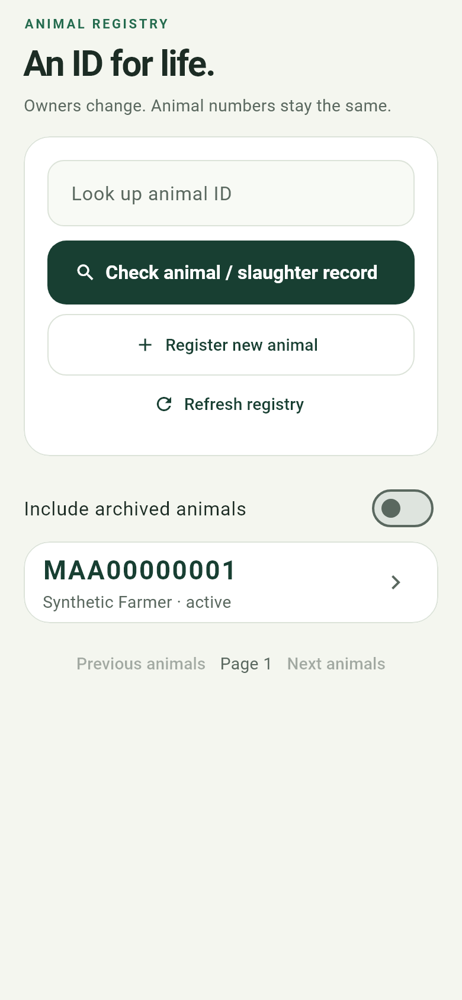
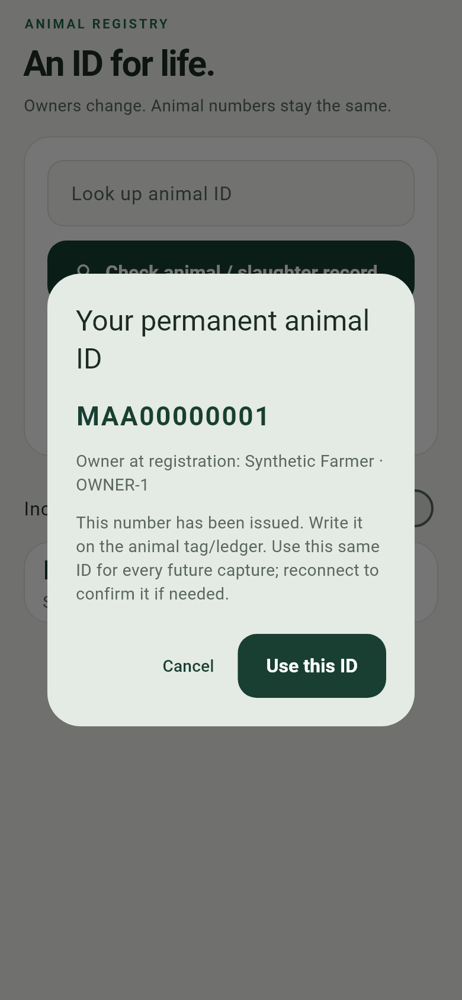
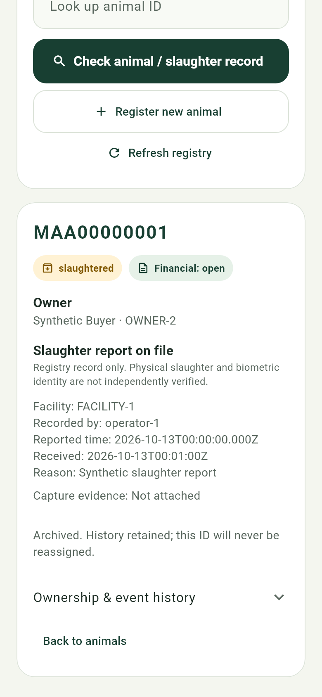

# Permanent cattle IDs, owners and terminal reports

## Field workflow

1. Connect to the **same canonical backend**. In Capture choose **New animal ID**,
   or Animals → **Register new animal**. Enter a stable owner reference
   (e.g. `OWNER-001`) and name. Register each physical animal only once.
2. The server allocates `MAA00000001`, `MAA00000002`, etc. Write the complete number
   on its tag and ledger, then press **Use this ID**. The display uses tabular
   digits for readability. These are internal IDs, not official government tags.
3. Every later photo/session/device uses that same animal ID. Keep the permanent
   external ear tag in the ledger too. Existing registered IDs still capture
   offline; issuing a new number requires the backend. Never invent an M-number.
4. Animals → look up the tag/ledger ID → **Change owner**. Enter the new owner's
   reference/name and reason. ID, photos and previous owners remain unchanged.
   A name edit for the same reference is not an ownership transfer.
5. **Record death** for a deceased animal; **Record slaughter** for slaughter,
   with a stable facility ID (e.g. `ABATTOIR-001`) and report notes. Confirm only
   after checking the animal/tag. These terminal states remove it from the active
   list. **Include archived animals** or direct lookup shows retained history.
   There is no hard-delete or reactivation button, and its number is not reused.
6. At an abattoir choose **Check animal / slaughter record**. Review lifecycle,
   owner, reporting operator, reported/received time and facility. “Slaughter
   report on file” means an authenticated report exists. It does **not** establish
   that this physical animal matches the ID or that slaughter independently occurred.

Owner references identify a person/farm in the operator's ledger; this MVP does
not provide owner accounts, owner consent signatures or legal ownership verification.
Only the original registering operator or an administrator can change the record.
All authenticated operators can look up registry records; credentials are for trusted
field staff, not publicly distributed. Financial `open`/`insured`/`collateral`
status remains separate; death/slaughter does not automatically settle a loan/policy.

## Reliability and compatibility

- Per-species `numbering` lives in YAML: cattle `M`, two series letters, eight
  digits; sheep uses the same structure with `S` and stays **disabled**. Config
  version 3 adds `series_letters: 2`; old configs default to zero letters. No
  sheep model/crop logic was added. After this approved transition, freeze the
  prefix/width/series size. Numbers may have gaps; never reset the counter.
- PostgreSQL allocates numbers atomically. Global numbered-ID uniqueness and
  forward-only counter/retained-profile triggers guard against reuse. This guarantee
  is for **one authoritative database**, not independently writable installations.
  Never issue official numbers from a test/restore clone. Restoring stale data
  after later IDs were issued requires reconciliation before writes resume.
- Every mutation requires `Idempotency-Key`; the server stores its immutable
  response. Same actor/key/body replays; a changed body/operation returns 409.
  Mobile saves the original request before sending. Timeout/restart retries the
  same key, timestamp, GPS and body; an issued ID stays visible until acknowledged.
  Known 404/409/422 rejections stay in the journal and require correction/review.
  Corrupt journals block new mutations and remain available for backup.
- Additive Alembic `0005` creates `animal_number_counters`, `animal_profiles` and
  `registry_receipts`. Legacy IDs/photos/financial fields are preserved, never
  automatically renamed. Legacy records without a profile appear active with
  owner “Not recorded”; the registering operator/admin may record their owner.
  Numeric managed prefixes are reserved; uploads cannot create an unissued M-ID.
- Archives retain photos and immutable actor/server time/reported time/GPS audit
  events. GPS is nullable and operator/device supplied, not independent location
  proof. Delayed uploads to an existing archived ID retain evidence without
  reactivating it; the normal registry capture selector offers active records only.
- Optional `capture_id` links a matching, permitted scan and stored image hash
  to a terminal report. In the phone form, paste the **Uploaded capture UUID**
  from Saved upload receipts; leave blank if no uploaded frame is available.
  A local request key is not a UUID. The phone validates the shape, normalizes
  case and keeps that attachment unchanged on retry; the server verifies animal
  and operator permission. Recorded UUID/hash are selectable in the archived
  report. No image-based slaughter verdict is produced.
- Phone ZIP backups include registry requests, acknowledgements and partial writes;
  protect them because owner names and report metadata are sensitive. Save a copy
  outside the app. Desktop recovery preserves evidence; it does not auto-replay
  mutations or import them into another authority.

Unique numbers prevent number collisions, **not** two registrations of the same
physical animal under different numbers. Continue the independent tag/roster checks.
Biometric duplicate/identity validation still needs the real labeled dataset.

## API and local rollout

### Fixed-length series — active since the 2026-10-14 code milestone

```text
MAA00000001 ... MAA99999999
MAB00000001 ... MAZ99999999
MBA00000001 ... MZZ99999999
```

Each series contains 99,999,999 numbers (00000000 is not issued). The two A-Z
letters carry AA → AB and AZ → BA automatically; every new cattle ID remains
11 characters. Full configured capacity is 67,599,999,324 IDs. After MZZ99999999,
new issuance returns 503; it never wraps, reuses an ID or silently grows its width.

The same existing `M` counter is a forward-only ordinal across all series. If it
was already 20, the next issued ID is MAA00000021, preserving gaps rather than
resetting it. Old M00000001-style IDs and their immutable receipts/paths/owners
remain valid and are never renamed; an old request retry returns its original ID.
Both old numeric and new series namespaces are reserved against manual allocation.
Existing BigInteger storage supports the range; schema remains 0005, with no
additional migration or data rewrite. Back up and rebuild the backend/configs
together; keep a single authoritative allocator and avoid rolling mixed versions.

Bearer authentication is required for every route below. Mutating routes additionally
require `Idempotency-Key` (16–128 ASCII letters/digits/underscores/hyphens).

| Route under `/api/v1/registry` | Purpose |
| --- | --- |
| `POST /animals` | `{species, owner:{owner_id,name}}` → 201 permanent ID |
| `GET /animals?species=cattle&lifecycle=active&limit=50&offset=0` | Bounded active list; also `deceased`, `slaughtered`, `all` |
| `GET /animals/cattle/{id}` | Current projection, owner, lifecycle and terminal record |
| `POST /animals/cattle/{id}/owner` | New owner, expected_version, timezone-aware observed_at, nullable GPS, reason |
| `POST /animals/cattle/{id}/retirement` | Same observation fields + lifecycle; facility_id required for slaughter; optional capture_id |
| `GET /animals/cattle/{id}/history?limit=50&offset=0` | Immutable events; mobile has previous/next pages of 50 |
| `GET /animals/cattle/{id}/slaughter-check` | Registry report only; biometric/independent verification explicitly false |

Before using new numbering, back up the existing backend using
[collection recovery instructions](COLLECTION_RELIABILITY.md). From `backend/`,
`docker compose up --build -d` applies migration 0005 on startup. This task tested
only the isolated stack; it did not deploy to the normal collection stack.
Rebuild the app with the existing README backend/operator defines.

## Verification — 2026-10-14 series extension

The later [MVP completion audit](MVP_COMPLETION_2026-10-14.md) also repairs
coherent registry reads, stale lookup cards, cross-instance phone journals,
capture attachment, history paging and linked storage paths. Lists/details use
one statement snapshot; a failed lookup clears the previous animal/report.
**Refresh registry** retries lookup after reconnecting. Completed checks below
describe the preceding numbering milestone; latest total is 339 passing tests.

194 backend/tooling, 48 research and 88 Flutter host tests passed; Ruff and Flutter
analysis clean. Cases cover AA/AB and AZ/BA carries, capacity/exhaustion, old config
defaults, case-insensitive collision skipping, old ID/capture/ownership and receipt
replay, mobile cached-rule examples and legacy journal recovery. A fresh isolated
biolivestock-numbering stack on 18002 verified eight parallel HTTP allocations
crossing each boundary and four concurrent same-key retries, MZZ99999999/503,
unchanged receipt replay after exhaustion, and a synthetic pending_model upload.
All backend/config hashes matched the running image.

Final debug APK built in 41.7 seconds; SHA-256
`29f37a78c3fe5c094bc1e68e5be988986b4706075da3eaa0013659b415dc0cd8`.
No API token configured. Four real-font widget tests passed again while rendering
the refreshed MAA previews above. All four test containers stopped with exit 0;
volumes/clones/fixtures retained. The boundary database is intentionally exhausted.

The existing reliability stack on 18001 continued the old counter under the new
format. Its 20 numeric-ID animal/profile rows, 27 audit events, two captures and
24 receipts match yesterday's restored database; old M00000001 issuance replayed
unchanged. Evidence: data/reliability/evidence/{registry-series,legacy-series}-20261014.json
and data/numbering/evidence/rollover-20261014.json. Boundary seeding advanced only
the new empty synthetic numbering test database, never existing/live counters.

Both updated stores backed up/restored to new isolated clones using bundles
data/backups/series-20261014 and data/backups/numbering-20261014. All registry,
animal and audit rows matched exactly, including mixed old/new IDs and the final
64-bit ordinal. Capture/file reconciliation was healthy. Historical proofs below
refer to the preceding nine-character numbering implementation.

## Verification — 2026-10-13 (historical)

171 backend/tooling, 48 research and 84 Flutter host tests passed; Ruff and Flutter
analysis clean. Journal tests cover restart/lost responses, changed payload/scopes,
rejection/corruption, mismatched acknowledgements, failed receipt writes and backup
retention. UI tests cover ID acknowledgement/recovery, owner/slaughter validation,
death retry/conflict cancellation, archives and 200% text on a narrow screen.
Capture integration preserves an already saved original's ID. Real-font mock
renders were visually inspected. Final Android debug APK built in 26.1 seconds,
SHA-256 `998d45179dada676d1dc1eca2313a38ae25cc108654899fb0ee58e25e488191e`;
no operator API token configured. Four widget cases also passed after final
financial-label clarification. Both isolated Docker services are stopped; data retained.

| Animal list | Issued ID | Archived report |
| --- | --- | --- |
|  |  |  |

The isolated `biolivestock-reliability` PostgreSQL stack on 18001 passed eight
parallel unique allocations, four concurrent replays returning one ID, a two-way
owner-version race (200/409), terminal replay, retained archived owner/ID, trigger
guards, authentication and disabled-sheep checks. A numbered synthetic JPEG passed
QC and persisted as `pending_model`; its stored hash is attached to the terminal
report. Source/config hashes matched the running container.

Backup `data/backups/registry-20261013` restored to a new database
`biolivestock_restore_registry_20261013` and `data/restores/registry-20261013`.
All counter/profile/receipt/animal/audit rows matched the source, not just counts.
The clone includes 20 profiles, 24 registry receipts, 27 animals, 35 audit events,
nine captures and eight upload receipts; reconciliation is healthy. Two runs left
synthetic fixtures: the first probe stopped on a correctly rejected SQL trigger
because its harness initially treated that expected rejection as a failure.
No real animal data was modified. Evidence is retained under
`data/reliability/evidence/registry*.json` and ignored by Git.

Physical Android/iOS operation remains unverified until a repaired/replacement
phone is available. All animal identity, model, slaughter authenticity and
real-world accuracy claims remain gated on real reviewed data.
