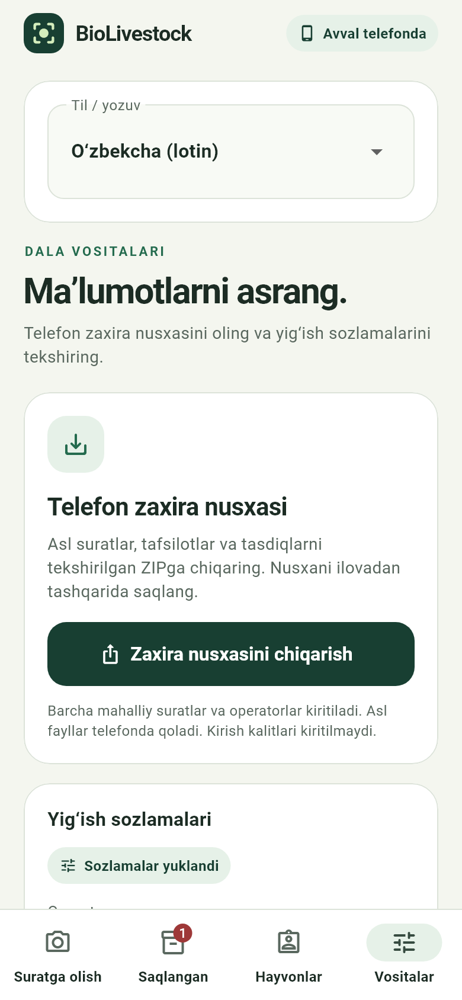
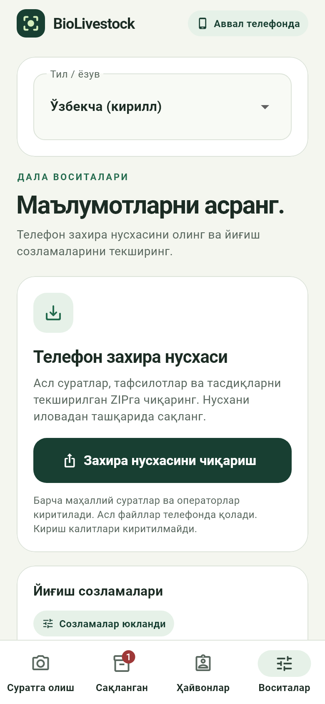
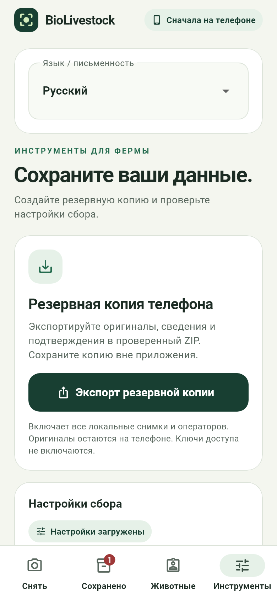
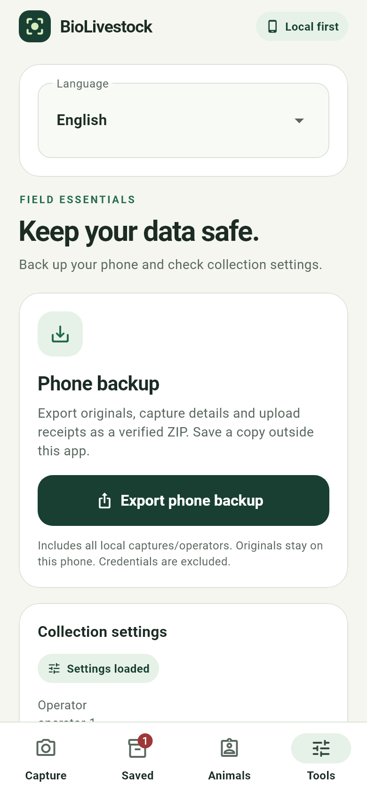

# App languages and scripts

Open **Tools / Vositalar / Воситалар / Инструменты** and choose a language.
The choice survives restart; switching retains the open photo, animal ID,
camera, pending originals and request keys. Default: Uzbek Latin. No network
or font download is needed for translations.

| Choice | Locale |
| --- | --- |
| O‘zbekcha (lotin) | uz-Latn |
| Ўзбекча (кирилл) | uz-Cyrl |
| Русский | ru |
| English | en |

Names/notes support `O‘ktam`, `Ўктам`, `Ғулом`, `Иван`; store exactly as typed.
Never transliterate user data. IDs such as `MAA00000001` and owner/facility
references use Latin ASCII letters, digits, underscores and hyphens. Cyrillic
`М` differs from Latin `M`. Species/status codes, timestamps, UUIDs and hashes
retain their API format. QC guidance is translated; raw server/audit details
remain technical evidence.

Four UTF-8 catalogs: `mobile/assets/l10n/`. English templates are stable keys;
`{0}`, `{1}` insert raw values once, so braces in names cannot become templates.
`UiText` explicitly marks display text; notices resolve again after language
changes. Update all four catalogs together. Tests reject missing keys, changed
placeholders and invalid Unicode.

Versioned preferences live separately from evidence at application-support
`preferences/language.json`: flushed temporary file + rename. Failed saves keep
the prior language with a notice; corruption keeps the default until an explicit
choice repairs the preference. Evidence backups exclude preferences/credentials.

The pinned Flutter SDK provides Uzbek Latin system widgets. Cyrillic delegates
adapt display/plural/date labels while preserving raw substitution arguments
and internal Cupertino date-order tokens. All variants are left-to-right.
Native permissions and keyboard follow OS settings. iOS builds/native plugins
remain unverified on Windows.

## Checks and field verification

From `mobile/`: `flutter pub get --enforce-lockfile`, `flutter analyze`,
`flutter test`, `flutter build apk --debug`.

109 Flutter tests passed, including 16 localization cases: actual selector,
restart/corruption/write failure, UTF-8 HTTP without charset, translated QC,
unchanged photo bytes/metadata/request keys during language switching, and
320×720 at 200% text with SDK fonts. Full Python suite: 252 passed (204
backend/tooling + 48 research), including Unicode owners/notes/history/replay.
Actual isolated Docker/PostgreSQL proof:
`data/reliability/evidence/unicode-20261014.json` and
`registry-i18n-20261014.json` (numbering/upload/QC/file/hash/source checks).
Accepted originals still use `pending_model`; sheep stays disabled.

Host mocks/synthetic data do not prove phone or animal accuracy. On a repaired
or replacement phone, use README operator configuration and verify native
camera/GPS/keyboard, restart/upload, language choice and backup sharing.

Actual Flutter widget renders, using synthetic camera/data:

| Uzbek Latin | Uzbek Cyrillic |
| --- | --- |
|  |  |

| Russian | English |
| --- | --- |
|  |  |

Final Android debug APK: `mobile/build/app/outputs/flutter-apk/app-debug.apk`,
SHA-256 `a4012b93d54f4f980680d9c1fcdf58836d7d91f2d41b7dc07a0202dddd966a3f`; all four bundled catalogs byte-match source.
Built in 50.3 seconds without an operator token; rebuild with README defines.
