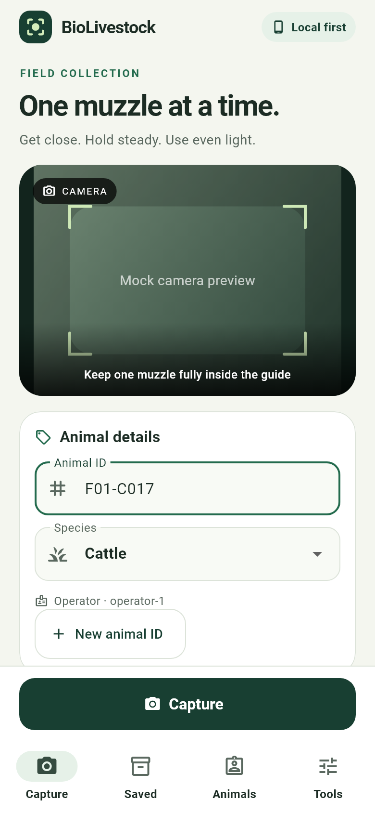
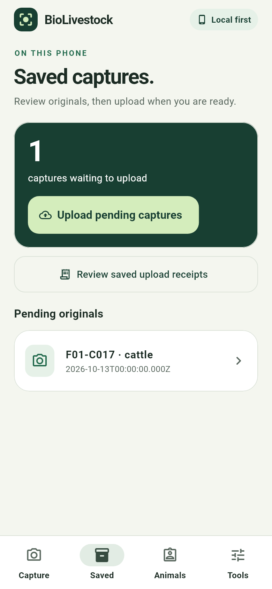
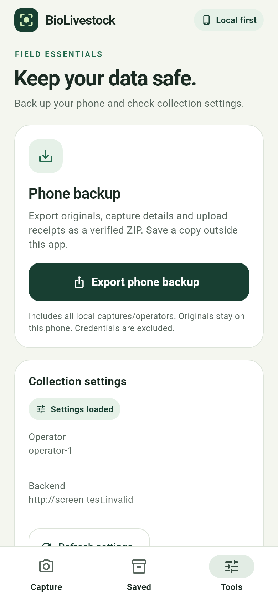

# Field capture design — 2026-10-13

**Multilingual update (2026-10-14):** four persisted offline UI variants, Cyrillic system labels, Unicode fields and responsive headings. 109 Flutter tests passed; see [languages and previews](LANGUAGES.md). The prior artifact/test evidence below is historical.

**Previous MVP completion audit (2026-10-14):** 93 full Flutter host tests passed; analyzer clean.
Final debug APK SHA-256 `f174e598090052164af0be2746b029b60b56be672fbc9c5f32c3f29cf5669b77`.
Actual widget previews below are refreshed for four-tab navigation. Refresh, paged history and optional uploaded UUID evidence are available. Permanent-ID
dialogs and report previews: [ANIMAL_REGISTRY.md](ANIMAL_REGISTRY.md). These use
mock records and SDK fonts; physical-device operation remains unverified.

The native Flutter app now separates **Capture**, **Saved**, **Animals** and **Tools**. The
previous screen put queue management and backup controls between the form and
camera. The new capture screen puts the camera first and keeps the primary action
above navigation, with animal details, readable QC feedback and preserved originals.

## References and decisions

- [Herdwatch](https://herdwatch.com/livestock-apps/): public livestock recording,
  animal lists and offline workflows informed the separate saved-capture view.
- [Datamars Active Tag](https://activetag.datamars.com/en/): public animal/status
  screens informed clear cards, labels and visible state; monitoring features
  are not represented as BioLivestock capabilities.
- [CattleEye](https://cattleeye.com/en-gb): public herd/individual-animal dashboard
  organization was reviewed as a related product, not a camera-capture equivalent.
- [Flutter accessibility guidance](https://docs.flutter.dev/ui/accessibility):
  large targets, contrast and text scaling guide layout checks.

These were public page/image references, not paid/authenticated app walkthroughs
or an exhaustive survey. No third-party brand assets or screenshots are bundled.
An attempted browser inspection failed initialization; no native phone inspection
was available. Review decisions are our interpretation of these references.

Forest green, ivory surfaces, mint status tags and warm caution/red error feedback
give the field workflow a consistent hierarchy. Typography uses native Roboto
without font downloads. Shared colors, spacing, cards, headings and controls live
in `mobile/lib/app_design.dart`; capture logic remains species/config driven.

## Screen behavior

| Surface | Behavior |
| --- | --- |
| Capture | Visible preview, visual positioning guide, animal ID/species, configured operator, fixed capture action. Invalid input is brought into view before taking a photo. |
| Review | Full original preview, local QC result, explicit GPS absence, expandable measurements/timestamp/request key. Failed QC offers retake; accepted captures offer upload or next capture. |
| Saved | Pending capture count, explicit manual batch upload, original review, existing 50-item pagination, receipt review. Counts are captures, not verified animal identities. |
| Animals | Server-issued permanent MAA-series IDs with readable tabular digits; owner transfers, death/slaughter archives, paginated records and report/history lookup. Financial status is explicitly separate. |
| Receipts | Readable acknowledgement cards, selectable UUID/request/path, existing pagination and close action. |
| Tools | Verified ZIP backup/share, scope/retention explanation, cached-rule status, configured operator/backend, refresh and field checklist. |
| Errors | Separate error icon/color plus text; uploads/backup failures retain local evidence. Permission failure offers retry. |

The guide is a positioning aid, not a detected muzzle, crop, liveness result or
identity confidence. A dark camera caption gradient keeps guidance readable
against bright frames. There is no fake online indicator: cached-rule/local-save
labels describe known state. Registry adds separate mutation journals and additive
schema 0005; the existing capture/auth/QC and upload-receipt contract is preserved. Sheep stays
disabled; no checkpoint means server uploads still use `pending_model`.

Capture/tools scroll as bounded forms so validation remains mounted even at large
text sizes. Saved items use a separate scrolling list with the existing page limit.
Navigation preserves an open capture; another original cannot replace it before
the user finishes or moves to the next capture. Keyboard submission/capture dismiss
the keyboard; missing operator setup prevents capture.

## Review and repeat checks

Actual Flutter widgets are rendered with SDK Roboto/Material icon fonts and mocked
camera/GPS/API boundaries. Images under ignored `data/design/20261013/` show the
capture, review, saved, tools, receipts, retake and large-text states. These are
host-rendered UI evidence, not physical camera screenshots or animal images.

```powershell
cd 'D:\Coding projects\moliddetector\mobile'
flutter analyze --no-pub
flutter test --no-pub
$env:DESIGN_SCREENSHOTS='1'
flutter test --no-pub test/capture_screen_test.dart
Remove-Item Env:DESIGN_SCREENSHOTS
flutter build apk --debug --no-pub
```

Tests preserve camera/GPS denial, lifecycle, offline restart, full storage, ZIP
export, partial upload and pagination checks. Additional checks cover 320×720
with 200% text, failed upload/recovery/receipt review, QC rejection and Android
touch-target guidance. Physical Android/iOS rendering, camera texture/orientation,
real keyboard/share sheet, sunlight and gloved operation still need a device.
English UI is retained; translation is a separate future product decision.

**Earlier design milestone:** 68 Flutter host tests passed; final analyzer reported no issues.
The small-phone check also confirms invalid Animal ID feedback is scrolled above
the fixed action without taking a photo. Android touch-target guidance passed on
Capture and Tools. Final debug APK built in 26.0 seconds, SHA-256
`9850861814a9972ecb96938732f3e4b46429763f47d25d979dd66f12e4eafcc1`.
It contains no configured API token. Backend/research were not changed or rerun
for this UI-only milestone; their earlier verification remains in PROGRESS.md.

Reviewed, synthetic host renders (not device screenshots):

| Capture | Saved | Tools |
| --- | --- | --- |
|  |  |  |
